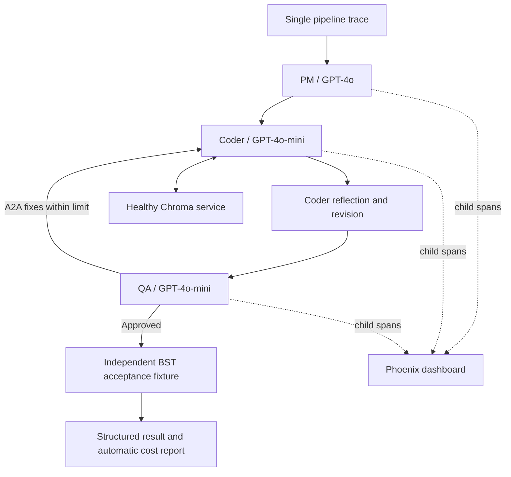
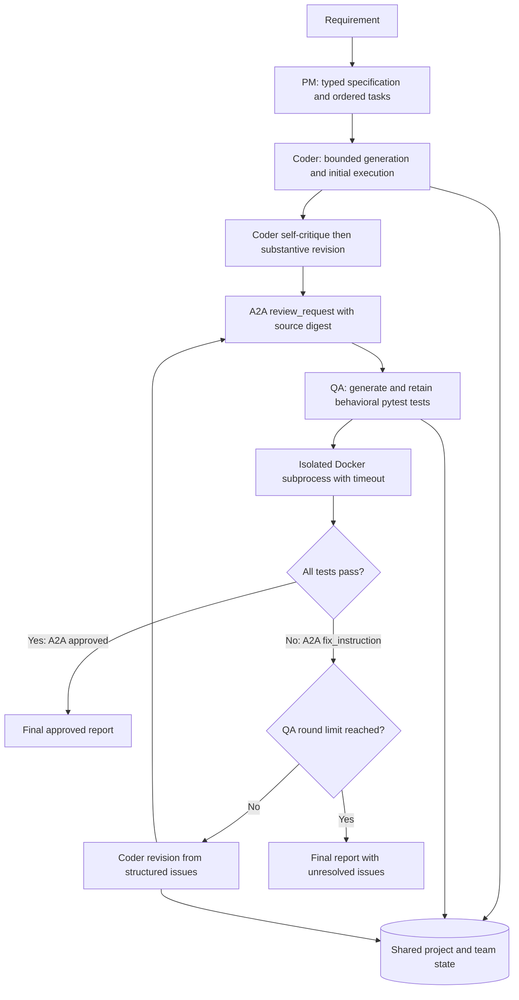
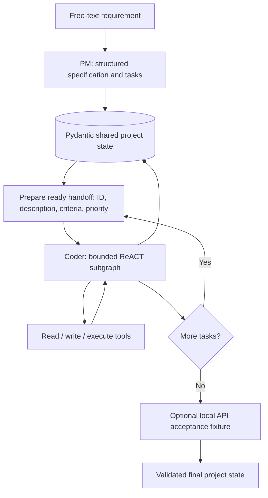

# Multi-Agent Development Team — PM + Coder + QA

Saras AI Institute · Build Autonomous Multi-Agent Systems · Modules 1–4.


## Module 4: traced and recoverable deployment

Module 4 runs the complete PM/Coder/QA team with Phoenix tracing, bounded call
retries and circuit breakers, prompt caching, and automatic token/cost reports.
The PM uses GPT-4o; Coder and QA use GPT-4o-mini by default. Earlier submissions
remain on their own branches; this milestone is on `module-4`.



The graph above summarizes role flow; initial generation uses the Module 2 task
workflow, and QA fixes use the Module 3 revision path. All invocations are beneath
one root trace, including reflection, fixes and final acceptance verification.

**Clean setup:** use Docker Desktop/Engine and Python 3.11 for local tests.
Allow at least 10 GB of free disk space for the first image build and containers.
Copy `.env.example` to `.env` and set your own `LLM_API_KEY` locally. Never commit it.

```bash
cp .env.example .env
# Edit .env locally, then start the default published BST task:
docker compose up --build -d
docker compose wait agent
docker compose logs agent
```

Compose waits for Chroma and Phoenix health checks before starting the agent.
The first build downloads pinned Python dependencies and the public embedding
model into the image. It can take several minutes. No existing Chroma volume or
host embedding cache is needed. `docker compose up --build` also works in the
foreground; stop it after inspecting the result.

Open [Phoenix](http://localhost:6006), select project `module4`, and inspect the
trace ID printed by the agent. The dashboard remains running after the agent exits.
Artifacts are written automatically to:

- `docs/results/<run_id>.json`: final state, code, QA and independent fixture result.
- `docs/cost_reports/<run_id>.json`: per-call and per-agent usage and estimated USD.
- `docs/traces/<run_id>.json`: exported spans with parent IDs and required metadata.
- `docs/run_logs/<run_id>.jsonl`: structured events with the same run and trace IDs.

For the default BST task, exit 0 / `approved=true` means the current code passed
QA and the local BST fixture.
Exit 1 / `approved=false` retains the failure or unresolved issues. A cache hit or
open circuit never fabricates success. Missing provider usage is flagged explicitly.

```bash
# Local automated checks (no paid calls by default):
python3.11 -m venv .venv
source .venv/bin/activate
pip install -r requirements.txt
python -m pytest -q
# Opt-in clean Compose end-to-end test: makes real model calls and leaves dashboard running.
RUN_MODULE4_COMPOSE=1 python -m pytest tests/test_production_e2e.py -q
```

Before that isolated acceptance run, stop another Compose stack using port 6006.
The test creates a new Compose project with fresh volumes, records startup logs and
checks readiness precedes agent execution and every exported span arrived in Phoenix.
Run artifacts use the standard `docs/` directories above; deployment logs, the
Phoenix response and the project name are in `docs/module4/deployment/`.
To stop that test stack later, run `docker compose -p <recorded-project-name> down`.
`docker compose down` stops the default stack without deleting its data volumes.

Configuration includes `PM_MODEL`, `CODER_MODEL`, `QA_MODEL`,
`CALL_MAX_RETRIES` (0–3), `CIRCUIT_COOLDOWN_SECONDS`, `RETRY_BASE_DELAY_SECONDS`,
`PROMPT_CACHE_TTL_SECONDS`, per-role token rates, and the existing QA limits.
`OUTPUT_DIR` selects a host artifact directory for Compose. For local CLI use,
set `CHROMA_HOST`/`CHROMA_PORT` and `PHOENIX_TRACES_ENDPOINT` as appropriate,
then run `python production_main.py`. With no Chroma host, local CLI uses embedded
Chroma; Compose always uses the readiness-gated service.

[Module 4 rubric map, interfaces and recovery guide](docs/module4/README.md) ·
[Passing clean-deployment evidence](docs/module4/validation.md)

## Module 3: complete three-agent team

The PM and Coder remain in LangGraph. A Coder self-critique step produces revised
application code before QA receives it. QA independently generates behavioral
pytest tests, runs them in Docker with a timeout, and returns typed issues and fix
instructions. The Coder revises the application and QA reruns the **same tests**.



**Protocol choice:** the course's simplified in-process A2A protocol fits the
Coder/QA peer interaction. `orchestration/a2a.py` serializes messages to JSON,
routes them through agent queues, validates intent-specific payloads and matches
responses by correlation ID, task ID and source digest. Every envelope contains
`sender`, `receiver`, `intent`, `payload` and `correlation_id`. This is the course
protocol, not a claim of external HTTP A2A interoperability. MCP is not implemented
because the rubric requires only one route. The optional debate lab is omitted.

After the common Python setup below:

```bash
docker build -f Dockerfile.qa -t coder-python-qa:module3 .
python team_main.py --output module3-result.json
# Reproduce live evidence plus controlled repair and limit probes:
python -m scripts.verify_module3
```

The default task implements a linked list with `insert`, `delete`, `search` and
`reverse`. Our explicit local contract is `linked_list.py`, `LinkedList()`, and
nodes with `data`/`next`: insert appends; delete removes the first match and returns
a boolean; search returns a boolean; reverse operates in place and returns None.
These method semantics supplement the course task, which does not specify them.
Tests cover empty lists, singletons, duplicates and missing values.

Set `QA_MAX_ITERATIONS` in `.env` to change the total QA round budget (default **5**,
including the initial review; supported range 1–20). Thus at most four QA-driven
fixes occur at the default setting. `QA_TIMEOUT_SECONDS` defaults to **10** and
supports values greater than zero up to 60. Initial Coder tasks retain their separate
ten-model-call bound. Reflection is two bounded model calls: critique, then revision.
A revision must change the parsed Python code; comments alone are rejected.

Exit 0 means the final current source passed QA; exit 1 means unresolved failures
or a workflow error. QA never accepts an empty test run, skipped tests, missing
execution results or an old source version as approval. Test assertions and
coverage maps are checked structurally, but generated tests remain fallible;
review their behavioral coverage rather than treating approval as proof.

```bash
python -m pytest -q
RUN_MODULE3_DOCKER_TESTS=1 python -m pytest tests/test_qa_team.py -q
python -m scripts.verify_module3 --controlled-only
```

The default tests use scripted models and trusted fixtures; the controlled probes
use real Docker pytest runs with clearly labeled scripted model responses. The
separate live demo uses the configured model for PM, Coder, reflection and QA.
No person edits or repairs its generated code during a run.

[Module 3 rubric evidence](docs/module3/README.md) ·
[Live run state](docs/module3/live-final-state.json) ·
[A2A message log](docs/module3/a2a-messages.json) ·
[Real model repair after seeded failure](docs/module3/live-seeded-repair.json)

Module 3 is published on `module-3`. Earlier submissions remain on `main`
(Module 1) and `module-2` (Module 2). Submit the Module 3 branch URL with its commit SHA.

## Module 2: PM → Coder

Module 2 retains **LangGraph and GPT-4o**. The PM converts a free-text requirement
into a validated specification and an ordered task list. The Coder consumes each
ready handoff and updates the same typed project state after each task.



PM and Coder execute in one workflow and process; Docker runs generated code only.
Shared state preserves the original requirement, specification, original and
consolidated tasks, per-task status, handoff history and accumulated code. Plans
larger than eight tasks are grouped in order, retaining every original description,
acceptance criterion and source task ID. The Coder has at most ten model calls per
task. A failed task stops the workflow and keeps earlier outputs for inspection.

After the setup below, build the Flask execution image and run the published task:

```bash
docker build -f Dockerfile.executor -t coder-python-api:module2 .
python project_main.py --verify-api --output module2-result.json
# Or provide a different requirement:
python project_main.py "Build a REST API with GET /health and POST /echo with input validation" --verify-api
```

The default task is the course's published health/echo API requirement. The
`--verify-api` option uses **our documented local request fixture**, not an
instructor-supplied fixture. It expects JSON objects to echo unchanged, rejects
malformed/non-object JSON with 400, and rejects non-JSON input with 415. These
choices must be compared with the instructor fixture when it becomes available.
The Flask image supports sibling imports when the generated assertion script
adds its own directory to `sys.path`; the Module 1 image remains standard-library only.

```bash
python -m pytest -q
RUN_MODULE2_DOCKER_TESTS=1 python -m pytest tests/test_api_fixture.py -q
# Uses the API key from .env, incurs model usage, and writes fresh run evidence:
python -m scripts.verify_module2
```

[Module 2 evidence and rubric map](docs/module2/README.md) ·
[Live state transitions](docs/module2/live-state-trace.json) ·
[Final state and actual request results](docs/module2/live-final-state.json)

Module 2 is published on the `module-2` branch so the Module 1 submission remains
available on `main`. Optional Lab 2.4 and a new cross-framework comparison are not
part of this milestone; there is no framework change to justify.

## Graded Module 1 Coder Agent

The main project implements the six C1.1–C1.6 criteria using **LangGraph + GPT-4o**.
See the [rubric evidence map](docs/rubric-evidence.md) and the
[instrumented live memory/tool runs](docs/rubric-live-evidence.json).
The course-wide grading rubric states that recommended labs and multiple
frameworks are optional; the linked lab forks are supplementary work.

## Supporting course labs

The four official lab forks are completed and tested:

| Lab | Repository | Results |
|---|---|---|
| 1.1 | [Memory](https://github.com/sachinmehra1/Multi-agents-lab-1-1-memory) | 5 offline tests + live recall passed |
| 1.2 | [Tools](https://github.com/sachinmehra1/Multi-agents-lab-1-2-tools) | 24 tests + live demo passed |
| 1.3 | [ReACT Coder](https://github.com/sachinmehra1/Multi-agents-lab-1-3-react-coder) | 24 supplied tests including live + 3 regression tests passed |
| 1.4 | [LangGraph / AutoGen / CrewAI](https://github.com/sachinmehra1/Multi-agents-lab-1-4-langgraph-autogen-crewai) | 29 live tests + 9 artifact tests passed |

**Submit this repository URL:** https://github.com/sachinmehra1/multi-agent-dev-team

[Lab evidence and reproduction notes](docs/course-labs.md) ·
[Actual framework comparison](https://github.com/sachinmehra1/Multi-agents-lab-1-4-langgraph-autogen-crewai/blob/main/comparison/results.json)

Live labs used the owner's OpenAI account directly. No user keys are included.
LMS submission remains pending.

## Standalone Coder Agent

A single LangGraph Coder agent accepts a natural-language Python task, writes files,
executes them in a restricted container, and returns Pydantic-validated JSON.
Module 2 adds the PM; Module 3 adds QA and the revision loop.

**Delivery status:** implemented, tested locally, and published at
https://github.com/sachinmehra1/multi-agent-dev-team. LMS submission remains pending.
The standalone implementation and the official lab forks have separate test evidence.
See [submission instructions](docs/submission.md) and [test evidence](docs/verification.md).
The live GPT-4o + Chroma + Docker addition task passed; its actual result is in
[the live run record](docs/live-addition-output.json).

## Setup

Use Python 3.11, Git and Docker Engine/Desktop (Linux containers). Earlier milestones were also tested with Python 3.12.

```bash
python3 -m venv .venv
source .venv/bin/activate
# Windows PowerShell: .venv\Scripts\Activate.ps1
python -m pip install -r requirements.txt
cp .env.example .env
# Windows PowerShell: Copy-Item .env.example .env
```

Set `LLM_API_KEY` in your local `.env`. Default model: `gpt-4o`, as specified in the
course guide. Do not paste credentials into source files, prompts, logs or Git.
Alternatively use a running Ollama server with an installed JSON-capable model:
set `LLM_BASE_URL=http://localhost:11434/v1`, `LLM_MODEL` to its exact model name,
and `LLM_API_KEY=ollama`. Provider/model availability must be verified in your account.
The adapter uses the OpenAI-compatible chat endpoint via HTTP and validates responses
locally, so model-provided JSON is never trusted without validation.

```bash
docker pull python:3.12-slim
python main.py "Write a Python function to sort numbers, add assertions for empty and duplicate inputs, and execute it."
```

First use downloads Chroma's local ONNX MiniLM embedding model (~80 MB). Subsequent
runs use its cache. Chroma data persists in `.chroma/`; generated files live under
`workspace/<session>/`. Do not use a workspace containing credentials or personal files.
Use `--session lesson1` on later invocations to retrieve that session's prior context.
The sliding conversation window is in-process; semantic memory survives restarts.
A graph instance is single-user and sequential, not thread-safe.

JSON goes to stdout; metadata-only JSON events go to stderr. Exit 0 means the agent
reported completion with a successful latest execution; exit 1 means incomplete or
failed. Successful execution is evidence of passing the generated checks, not a proof
that arbitrary requirements are correct. Review generated code before relying on it.

## Required repository structure

```text
multi-agent-dev-team/
├── agents/                 # coder_agent.py, pm_agent.py, qa_agent.py
├── tools/                  # confined file I/O, bounded Docker subprocess, registry
├── orchestration/          # LangGraph, Pydantic state/output, LLM, two-layer memory
├── tests/                  # smoke, failures, memory, opt-in integrations
├── docs/                   # architecture, requirements, verification, submission
├── .env.example
├── Dockerfile
├── docker-compose.yml
├── requirements.txt
├── main.py
└── README.md
```

## Design decisions

- **LangGraph:** explicit `think → act → think` graph with a finalization node makes
  budgets, transitions and failure behavior visible. It is the actual runtime,
  not an optional import or a mock framework.
- **Memory:** a deque retains the last N complete decision/observation exchanges
  (default 5). The task and system instructions remain pinned. Chroma embeds and
  retrieves the top 3 matching records before **every** model call, including a
  validation retry. Task context and observations are stored after each tool call.
  Session metadata filters prevent retrieval across sessions; switching session
  clears the in-process conversation. Retrieved content is explicitly untrusted.
- **ReACT:** each response supplies a short operational `thought`, a typed action
  and typed arguments. These are action summaries, not private reasoning traces.
  The actual action summaries form the returned execution plan.
- **Guards:** at most 10 total model calls; a malformed response gets one repair
  within that budget. The third consecutive identical action is blocked, as is a
  repeating three-action cycle. Excess context stops with a structured error.
- **Tools:** `read_file`, `write_file`, `execute_python` and the aliases `run_code` and `exec_python`.
  File tools reject absolute paths, traversal, hidden paths and symlinks. UTF-8
  files are capped at 100 KB each, 64 files and a 1 MB execution snapshot.
- **Sandbox:** Docker is mandatory for model-generated code. Each execution gets a
  fresh source snapshot via stdin, no host bind mounts, no network, a read-only
  root filesystem, an unprivileged user, no capabilities, limited memory/CPU/PIDs,
  temporary storage and capped output. A host subprocess enforces a configurable
  timeout (10 seconds by default). Timeout/overflow triggers container removal.
  There is no `eval`, shell command execution, or automatic unsafe fallback.
- **Output integrity:** final code and filenames come from actual file operations.
  Execution results come from the runner. Writing a file invalidates earlier test
  evidence; a model cannot mark completion after a failed or missing execution.
- **Observability:** logs include model/tool calls, token usage and termination
  metadata, without raw prompts, responses, source or credentials. `total_tokens`
  uses provider-reported usage (0 if omitted). Dollar pricing is not guessed.

Full details: [architecture](docs/architecture.md), [requirements map](docs/requirements.md).

## Structured output

```json
{
  "task_complete": true,
  "code": "# File: add.py\nprint(2 + 3)",
  "explanation": "Implemented and checked addition.",
  "plan": ["Write the addition script", "Run the script"],
  "result": {"status": "passed", "stdout": "5\n", "stderr": "", "exit_code": 0},
  "files_written": ["add.py"],
  "iterations_used": 3,
  "total_tokens": 123,
  "error": null,
  "warnings": []
}
```

This is an illustrative shape, not a recorded live-model result. Result statuses:
`not_run`, `passed`, `failed`, `timeout`, `unavailable`, `output_limit`.

## Tests

```bash
python -m pytest -q
# Opt in individually (PowerShell: set $env:RUN_DOCKER_TESTS="1", then run pytest):
RUN_DOCKER_TESTS=1 python -m pytest tests/test_integration.py -q
RUN_SEMANTIC_TESTS=1 python -m pytest tests/test_integration.py -q
RUN_LIVE_LLM=1 python -m pytest tests/test_integration.py -q
```

The default suite uses the real LangGraph and Chroma with deterministic test vectors,
a scripted model and explicitly trusted fixture code in a local subprocess. This
makes tests free and offline after dependency installation. It does **not** establish
live LLM quality or Docker isolation. The integration switches test those separately.
`trusted-local` is available to test code only through the Python API; it is not a
security sandbox and is never selected by the CLI or `build_agent`.
Live tests need environment variables exported in the shell (pytest does not load `.env`).

## Historical Module 1 Compose usage

These commands describe the `main` branch. On `module-4`, use the deployment commands above.

After preparing `.env` and pulling `python:3.12-slim`:

```bash
docker compose run --build --rm coder
# Or provide another task:
docker compose run --rm coder "Write and test an iterative factorial function."
```

Compose runs the trusted orchestrator with access to the host Docker socket, so it
can launch separate code sandboxes. **That socket grants host-level Docker control**;
only use this configuration with trusted orchestration source on a development machine.
Generated code never receives the socket or API credentials. For stronger separation,
run the CLI locally against a dedicated Docker daemon/VM. Compose's named volume
preserves workspace and memory; its embedding cache is temporary and may redownload.
Docker sandbox execution and timeout checks passed locally; the Compose build remains untested.

## Limits

Python standard-library, self-contained scripts are the intended Module 1 workload.
Execution uses Python isolated mode (`-I`), so sibling-module imports and third-party
packages are not supported by the default runner. Runtime writes occur only in the
disposable container and are not copied back; persistent source must use `write_file`.
Container isolation is not a formal guarantee against kernel vulnerabilities.
Path checks assume no hostile concurrent host process replacing workspace entries.
Memory and generated code can contain user-provided sensitive text: use non-sensitive
tasks, keep runtime directories private, and never commit them. No project/course PDFs
are bundled in this public-ready source distribution.
