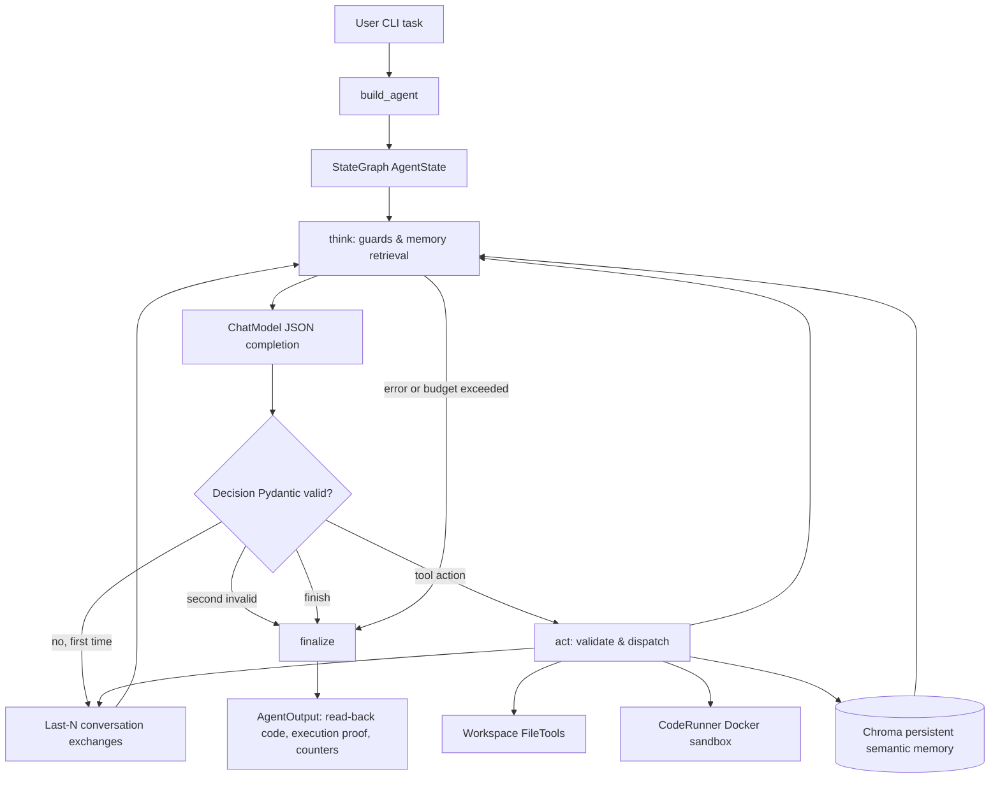

# Module 5 architecture — verified current implementation and target gaps

**Repository:** https://github.com/sachinmehra1/multi-agent-dev-team  
**Reference baseline:** main at e02873c83756758fbd60ac87ad9ea4c351e3d6e9 (26 October 2026).  
**Status:** Documentation of the verified *Coder-only* system, not a claim that the PM and QA agents are implemented.

## System overview

The current application is a single autonomous Python Coder agent built with LangGraph's `StateGraph(AgentState)`. The CLI in `main.py` builds a `CoderGraph` through `agents/coder_agent.py`. Each request is handled by `think`, `act`, and `finalize` nodes, with typed Pydantic `Decision`, `AgentState`, `ExecutionResult`, and `AgentOutput`. The Coder reads and writes confined workspace files and can execute a JSON snapshot of its workspace inside a short-lived, restricted Docker container. A bounded in-process conversation window and persistent session-filtered Chroma semantic memory provide context. Metadata-only logging records model/tool activity and provider-reported tokens. The `agents/pm_agent.py` and `agents/qa_agent.py` files are reserved stubs; their decision logic and integration are **not present** in the baseline.

## Actual data flow

## Agent roles and decision logic

| Role | Current state | Decisions |
| --- | --- | --- |
| Coder | Implemented | Produces JSON `Decision`; chooses `read_file`, `write_file`, `run_code` / aliases, or `finish`; reruns after tool observations. |
| Product Manager | **Stub only** | No task decomposition, acceptance criteria, or PM-to-Coder handoff implemented. |
| QA/Debugger | **Stub only** | No independent QA decision, test critique, or QA-to-Coder feedback loop implemented. |

## Orchestration choice

The actual graph has `START → think`, conditional edges `think → act/think/finalize`, `act → think`, and `finalize → END`. Explicit routing cleanly separates LLM reasoning from actual tool effects and output validation, whereas a conventional while loop would require recreating the same transitions and state-update controls manually. `AgentState` tracks decisions, failure flags, action signatures, latest execution evidence, files, iterations and token totals. Its `max_iterations` is validated from 1 through 10; `AgentOutput.iterations_used` is validated up to 10. Independently, LangGraph's `recursion_limit=40` caps graph traversal steps, not API requests.

## Integrity and security guarantees

- `think` checks an existing error, the ten-call cap, semantic-retrieval errors, and 100,000-character message budget before an LLM request.
- It retrieves Chroma memory before **each** model request, including invalid-JSON repair calls. Invalid structured outputs may be repaired once, within the ten-call allowance.
- Tool schemas are validated at `ToolRegistry.dispatch` using strict Pydantic models. The tools prevent hidden/absolute/traversal/symlink path access.
- `CodeRunner` uses Docker, not in-process `exec`. The README documents an unprivileged, read-only, network-isolated container with constrained resources and output.
- `act` resets `ExecutionResult` to `not_run` whenever a file changes. `finalize` refuses a positive completion outcome if the latest execution did not pass. Final code is read back from written workspace files rather than accepted from model text.
- The trusted orchestrator receives the Docker socket in Compose; a Docker socket grants broad host-daemon control and must be isolated from model-generated code.
- The current LLM adapter explicitly has **no retry decorator**. There is no circuit breaker or per-agent cost report in this baseline.

## Module 5 integration requirements still outstanding

1. Implement a PM agent with an acceptance-criteria specification and a typed handoff to Coder.
2. Implement a QA agent consuming execution evidence and reporting actionable defects; wire a bounded QA → Coder feedback path.
3. Add per-request LLM/tool retries with a shared physical-call budget and logged circuit-breaker state transitions.
4. Add one root trace with PM, Coder and QA child spans; emit per-agent token usage and cost reports.
5. Demonstrate at least three realistic E2E tasks and four grading demos using the *integrated* pipeline; report observed results.
6. Generate HTML API reference under `docs/api/`, verify clean Compose startup, record and link the 3–5-minute demo, and supply the exact final commit SHA.

This file intentionally does **not** represent missing functionality as complete.
