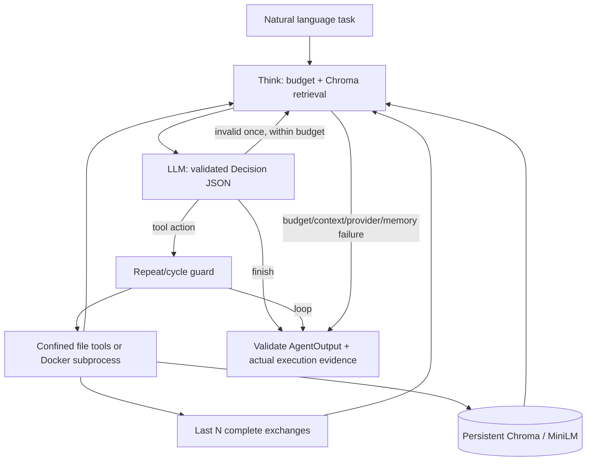

# Architecture and execution contract

`AgentState` is the typed graph state. `Decision` rejects unknown fields and invalid
finish/action combinations. Tool argument models disallow extras. Every termination
path returns an `AgentOutput`; the CLI catches startup failures with a redacted
structured error. The hard 10-call cap applies to response repairs too. The LangGraph
recursion limit of 40 is a separate failsafe, not the assignment's iteration counter.
There are no hidden model retries. HTTP model requests time out after 45 seconds.

Chroma uses its default local ONNX all-MiniLM-L6-v2 embeddings in production. The
collection is versioned as `coder_v1_minilm`; test-only embeddings use temporary
stores. Documents contain task context and bounded tool observations. The current task
is always retained, even when old exchanges leave the last-N window. A reused session
can recall prior task preferences. Model-generated memories remain untrusted and may
be wrong; this prototype does not solve memory poisoning or semantic deduplication.

The runner sends a validated UTF-8 file snapshot as JSON to a fixed bootstrap in a
fresh container. The bootstrap starts a Python subprocess without a shell. Limits:
10-second wall-clock default (including startup), 128 MiB memory, 0.5 CPU, 32 PIDs,
16 MiB each for work/tmp storage, 64 open descriptors, 1 MiB file-size ulimit, 64 KiB
combined stdout/stderr. Parent-process output readers stop accumulation on overflow.
A `finally` cleanup removes the container, including after CLI termination by timeout.
A Docker daemon failure during cleanup can require manual cleanup of `coder-*` containers.
Image pulls never happen inside the time budget (`--pull=never`); pull first.

The model's final code string is schema-validated but replaced by file readbacks.
Reported execution results, file paths, iterations and token counts come from the host.
Any successful write resets execution evidence. A finish request cannot claim completion
unless the last execution passed. These checks verify execution, not task semantics.

Official implementation references:
- [LangGraph StateGraph](https://reference.langchain.com/python/langgraph/graph)
- [Chroma Python client](https://docs.trychroma.com/reference/python)
- [Chroma collections](https://cookbook.chromadb.dev/core/collections/)
